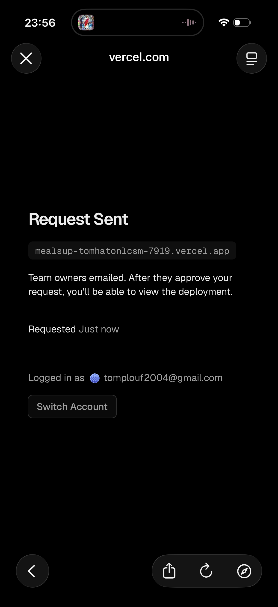

# MealsUp  
  
- [ ] Ajouter une section « contact » dans l’onglet profil, peut être un grand text area pour les laisser me faire des retour sur des choses à améliorer  
- [ ] Sur téléphone quand on veut ajouter une recette à son petit dej / diner etc ça zoom de fou et donc on voit rien  
- [ ] Quand on fait « générer ma liste de courses » depuis l’onglet d’accueil ça met bien dans les courses mais ça met une quantité astronomique d’ingrédients  
  
  
  
  
  
- [ ] Les sections ne marchent pas pour la liste de courses (flocons d’avoine, avocat, épinards, oeufs, levure, beurre, farine, lait, etc…) sont tous dans la section « autre » or ils appartiennent chacun a une catégorie spécifique. La catégorie « autre » devrait même pas exister, il devrait juste y avoir « frais », « traiteur » etcc  
- [ ] Ajouter un bouton « vider la liste » pour la liste des courses (si on a beaucoup d’items ça évite de tout supprimer un par un »  
- [ ] La page d’historique de courses est mal affichée sur téléphone on voit rien  
   
  
  
- [ ] Mettre la possibilité aussi de cliquer sur le nombre d’aliments et d’écrire le nombre au lieu de cliquer par exemple 12x sur « + »  
- [ ] Le placeholder du calendrier dans l’onglet frigo lors de l’ajout d’ingrédient ne s’affiche pas, ça fait juste un input vide visuellement (par contre quand on clique dessus ça marche)  
- [ ] Faire en sorte que lorsqu’on ne sélectionne pas un type d’équipement (et pas non plus le « tous ces équipements » du coup »,  les plats associés aient également un warning (d’une autre couleur que pour les produits exclus / restrictions alimentaires)  
- [ ] Problème de connexion via google sur téléphone, ça me renvoie vers une connexion Vercel et ça marche pas  
  
  
- [ ] Ajouter la possibilité de créer une recette (mettre le template de la recette et mettre des placeholder pour aider les utilisateurs à remplir les champs comme il faut, par ex pour les ingrédients et étapes un bouton « ajouter », etc..)  
- [ ] Faire en sorte de calculer le prix des articles en faisant une moyenne des prix selon les supermarchés (ou alors si possible dans l’onglet profil on le fait dire chez qui il va faire les courses avec un sélecteur) et en fonction de ça les prix sont marqués pour chaque produit. Ça permettrait de pouvoir ajouter un filtre « bas prix »  
